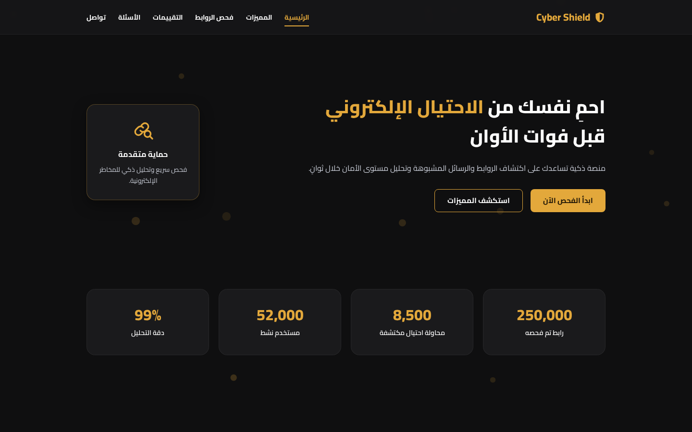
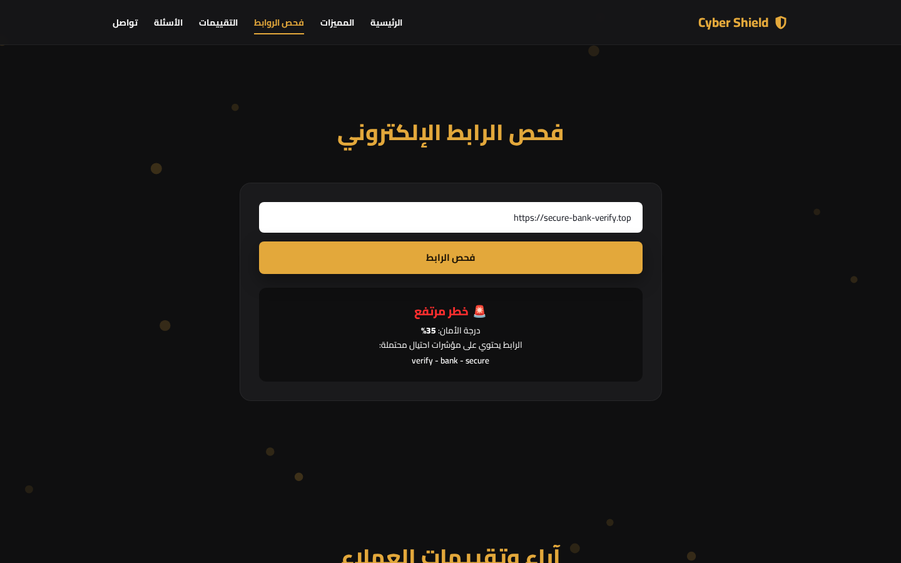

<div align="center" dir="rtl">

# 🛡️ Cyber Shield

**منصة عربية تساعدك على اكتشاف الروابط الاحتيالية والمشبوهة قبل فوات الأوان.**

   

</div>

<div dir="rtl">

## 📸 صور من الموقع

| الرئيسية | نتيجة فحص — خطر مرتفع |
|----------|------------------------|
|  |  |


## 🗂️ قاعدة بيانات الاحتيال

بالإضافة لتحليل شكل الرابط، يتحقق الموقع من النطاق في قاعدة بيانات **للنطاقات المُبلَّغ عنها كاحتيال** مبنية من مصادر عامة:

- [OpenPhish](https://openphish.com/): روابط تصيّد نشطة
- [Phishing.Database](https://github.com/Phishing-Database/Phishing.Database): نطاقات تصيّد نشطة

السكربت `scripts/build-threat-db.js` يحمّل القوائم ويقسمها إلى 256 ملف صغير داخل `data/threats/`، والمتصفح يحمّل الملف الوحيد اللي ممكن يحتوي النطاق، فالفحص سريع والرابط ما يطلع من جهاز المستخدم.

القاعدة تتحدّث **يومياً** تلقائياً مع كل نشر. لتشغيلها محلياً:

```bash
npm run build:threats
npm start
```

## ✨ المميزات

- **فحص الروابط**: ألصق أي رابط واحصل على درجة أمان، ومستوى الخطورة (آمن / متوسط / مرتفع) مع الأسباب.
- **تحليل ذكي**: كلمات التصيد الشائعة، امتدادات النطاقات المشبوهة، الاتصال غير المشفر، عناوين IP، رمز @، الأحرف المموّهة، الروابط المختصرة، وانتحال أسماء العلامات التجارية.
- **إحصائيات** بعدّاد متحرك.
- **آراء العملاء** مع إمكانية إضافة تقييم جديد (يُحفظ في المتصفح).
- **الأسئلة الشائعة** و**نموذج تواصل** مع التحقق من الحقول.
- تصميم **متجاوب** بالكامل ويدعم العربية (RTL) بدون أي مكتبات خارجية.

> الفحص يتم بالكامل داخل المتصفح ولا يُرسل الرابط لأي خادم. هو فحص توعوي مبني على مؤشرات، وليس بديلاً عن أدوات الفحص الأمني المتخصصة.

## 🚀 التشغيل

لا يحتاج أي تثبيت: افتح `index.html` في المتصفح، أو شغّل:

```bash
npx serve .
```

ولتشغيل اختبارات محرك الفحص:

```bash
npm test
```

## 🛠️ التقنيات

HTML5 · CSS3 · JavaScript (Vanilla) · Canvas API · IntersectionObserver · localStorage

## 📁 هيكلة المشروع

```
Cyber-Shield/
├── index.html
├── assets/
│   └── icons/            # SVG icons + favicon
├── css/
│   ├── variables.css     # colours, spacing, fonts
│   ├── base.css          # reset + base elements
│   ├── layout.css        # containers & sections
│   ├── animations.css
│   ├── responsive.css
│   ├── components/       # buttons, cards, forms, toast
│   └── sections/         # header, hero, stats, features, checker, reviews, faq, footer
├── js/
│   ├── main.js           # entry point
│   ├── core/
│   │   └── link-analyzer.js   # URL risk scoring (pure logic)
│   ├── modules/          # navigation, particles, reveal, counters, link-checker, reviews, faq, contact-form
│   └── utils/            # dom, storage, toast helpers
├── tests/
│   └── link-analyzer.test.mjs
├── docs/
│   └── ARCHITECTURE.md
└── screenshots/
```

## 👩‍💻 المطورة

**في نايف (Fay Naif)** — [GitHub](https://github.com/fay-naif)

## 📄 الرخصة

مرخّص تحت [MIT License](LICENSE).

</div>
